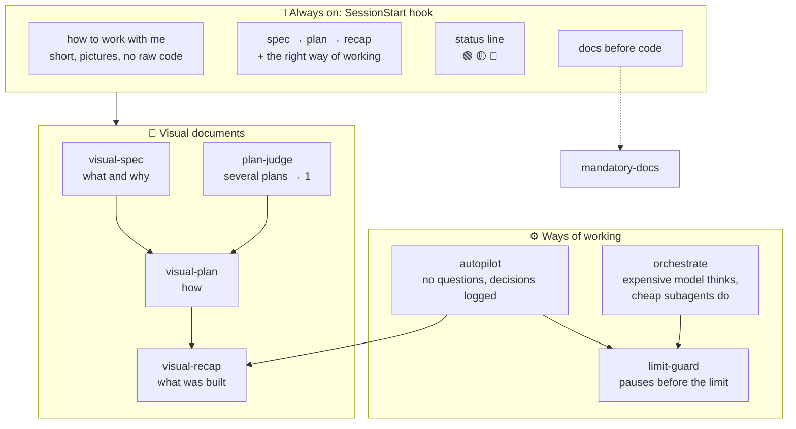
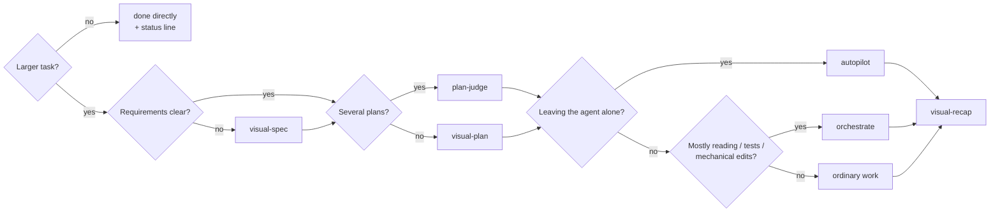
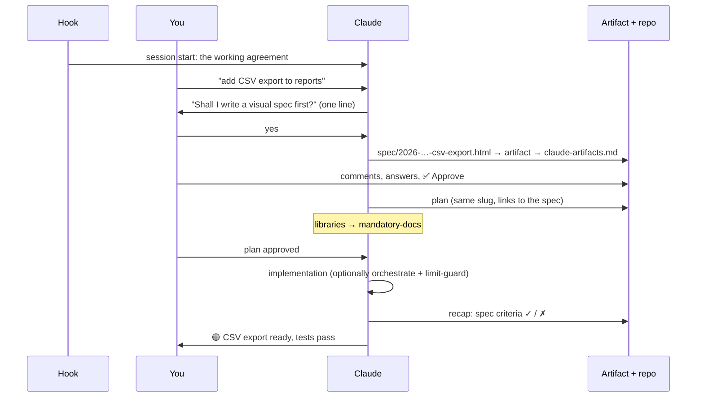
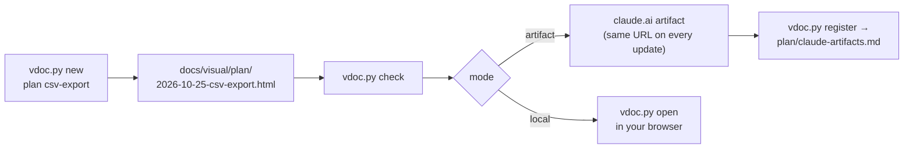
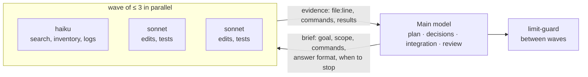
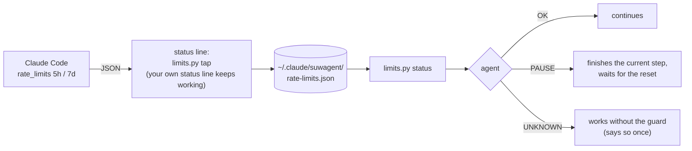

# suwagent

**Review your coding agent's work on visual pages, not walls of text.**
A Claude Code plugin: specs, plans and recaps as HTML pages you comment on and approve, a standing
working agreement for every session, and ways of working for long or heavy tasks.

<picture>
  <source media="(prefers-color-scheme: dark)" srcset="docs/assets/recap-dark.png">
  
</picture>

<sub>↑ A real page made by the plugin: <a href="docs/visual/recap/2026-10-25-suwagent-plugin.html">the recap of this repository</a> (in Polish, the owner's language).</sub>

## TL;DR

| **9** | **4** | **4** | **0** |
| :-: | :-: | :-: | :-: |
| skills (one is an alias) | parts of the working agreement | switches in Configure | accounts or external services |

```
/plugin marketplace add Manomenu/suwalski-agent-plugin
/plugin install suwagent@suwalski-agent-plugin
```

Requirements: `git` and `python3` (standard library only).

> [!TIP]
> You don't have to remember any of the commands. The agent offers a spec, a plan or a recap
> in one line when a task is big enough, and suggests a way of working when one fits.

## The plugin at a glance



## Cheat sheet: which one, when



### 📄 Visual documents

| Skill | When | What you get |
| :- | :- | :- |
| `/suwagent:visual-spec` | before planning a larger change | **what** and **why**: problem, goals and non-goals, scenarios, edge cases, UI sketches, acceptance criteria, open questions |
| `/suwagent:visual-plan` | before writing code | **how**: decisions with the options weighed, architecture diagram, file map, ordered steps with checks, verification, risks |
| `/suwagent:visual-recap` | after the work is done | **what was built and how it works**, without code or diffs: roles, a real scenario walked through, UI changes as screenshots with numbered marks, acceptance criteria checked with evidence, deviations, where to look carefully |
| `/suwagent:plan-judge` | 2+ plans for one task (Claude vs Codex, two sessions) | plans compared side by side against the real code, one verdict (adopt / hybrid / revise) as a visual plan |

### ⚙️ Ways of working

| Skill | Started by | When | How it works |
| :- | :- | :- | :- |
| `/suwagent:autopilot` | you | you leave the agent alone with a task | decides without routine questions, logs every decision, stops only for real blockers (secrets, destructive steps, merge/push), ends with a recap listing **decisions made without you** |
| `/suwagent:orchestrate`<br/>alias `efficient-frontier` | you | lots of reading, testing or mechanical edits | the main model plans, decides and reviews; `haiku` searches, `sonnet` edits and tests, at most 3 at a time |
| `/suwagent:limit-guard` | autopilot, orchestrate or you | long or parallel work on a Pro/Max plan | reads the real 5-hour and weekly usage and pauses new work at 90% / 95%, so you keep headroom |
| `/suwagent:mandatory-docs` | the agent, automatically | code that uses a library, framework, CLI or provider API | reads the official docs **of the installed version** and names its sources |

## One task from start to finish



## The standing working agreement

A `SessionStart` hook gives Claude Code the same rules in every project.

> [!NOTE]
> **Always on: how to work with me.** Replies in Polish and short, pictures over prose, no raw
> code to explain work, the proper way over the familiar one, an honest status.
> Make it yours in [`hooks/context/working-with-user.md`](plugins/suwagent/hooks/context/working-with-user.md).

The other parts are switches in `/plugin` → suwagent → **Configure**:

| Switch | What the agent does |
| :- | :- |
| **Spec → plan → recap** | offers a spec, then a plan before a larger change; codes only after the plan is approved; offers a recap at the end; recommends `autopilot`, `orchestrate` or nothing in one line when a larger task starts, and uses `plan-judge` by itself when there are several plans. Small changes are done directly. |
| **Status line** | ends every finished piece of work with 🟢 done, 🟡 something specific pending, or 🔴 waiting for you |
| **Docs before code** | reads the current official docs before using an external API (`mandatory-docs`) |
| **Where visual documents go** | `artifact` (default) or `local`: nothing leaves the machine, for client repositories |

## Visual documents: where they go



- One self-contained HTML file per page; the spec, plan and recap of the same work share a
  file name and link to each other.
- UI changes are shown on real screenshots with numbered frames and a legend.
  `vdoc.py shot <url> <png>` takes them with any installed headless Chrome, Edge or Firefox.
- Light and dark mode. Mermaid loads from a CDN; offline you see the diagram source.
- The local file is the source; the artifact is its published copy, so you can open and
  comment on it from any device.

> [!TIP]
> **Feedback goes back from the page.** Comment on the artifact, or answer the open questions,
> comment on sections, choose ✅ Approve or ✏️ Request changes, press **Copy feedback for the
> agent** and paste it into the chat. The agent updates the same page and the same artifact.

## Ways of working, inside

<details>
<summary><b>orchestrate</b>: the expensive model decides, cheap subagents do the volume</summary>



</details>

<details>
<summary><b>limit-guard</b>: reads your real plan usage between steps</summary>



> [!IMPORTANT]
> One-time setup: `/suwagent:limit-guard setup` adds the status line tap.

</details>

## Updates

Your installed copy is cached and does not change on its own:

- **Automatic**: `/plugin` → **Marketplaces** → `suwalski-agent-plugin` → **Enable auto-update**
  (off by default for third-party marketplaces).
- **Manual**: `/plugin marketplace update suwalski-agent-plugin`.

`plugin.json` has no `version` on purpose, so every pushed commit is a new version. With a
`version`, users only get an update when you bump it.

## Develop

<details>
<summary>Commands and repository layout</summary>

```bash
claude --plugin-dir ./plugins/suwagent        # try local changes without installing
claude plugin validate .                      # check the marketplace and the plugin
python3 plugins/suwagent/scripts/vdoc.py check docs/visual/recap/2026-10-25-suwagent-plugin.html
```

After editing the plugin in a running session, run `/reload-plugins`.

```
.claude-plugin/marketplace.json     the catalog: lists the plugins in this repository
plugins/suwagent/
  .claude-plugin/plugin.json        manifest: name, description, userConfig
  skills/visual-{spec,plan,recap}/  the visual document skills (SKILL.md each)
  skills/mandatory-docs/            docs-before-code procedure
  skills/autopilot/ orchestrate/ plan-judge/ limit-guard/   ways of working
  skills/efficient-frontier/        alias of orchestrate
  scripts/limits.py                 status line tap and usage check for limit-guard
  shared/template.html              the page: CSS + JS that render every block
  shared/authoring.md               rules shared by the three skills
  shared/components.md              the block catalog (HTML snippets)
  scripts/vdoc.py                   new / check / open / links / register / shot
  hooks/hooks.json                  SessionStart → scripts/session-context.sh
  hooks/context/*.md                the working agreement: how to work with the owner, documents and modes, status line, docs
docs/visual/                        visual documents of this repository (a real recap example)
docs/assets/                        screenshots for this README
```

Plugins can also carry subagents (`agents/`), MCP servers (`.mcp.json`), LSP servers, output
styles, themes, monitors, workflows and `bin/` executables. A `CLAUDE.md` inside a plugin is
**not** loaded: always-on instructions go in a hook like the one above, and instructions for a
task go in a skill.

</details>

## Credits

Inspired by [BuilderIO/skills](https://github.com/BuilderIO/skills) (MIT, © Builder.io):
`/visual-plan` and `/visual-recap` gave the idea for the visual documents, and the status line
and `mandatory-docs`, `autopilot`, `plan-judge`, `orchestrate` and `limit-guard` are adapted from
their `quick-recap`, `read-the-damn-docs`, `plow-ahead`, `plan-arbiter`, `efficient-frontier` and
`stay-within-limits`. Their visual skills need Builder's hosted Plans app; suwagent writes plain
HTML into the repository and publishes it as a claude.ai artifact, or keeps it local.
