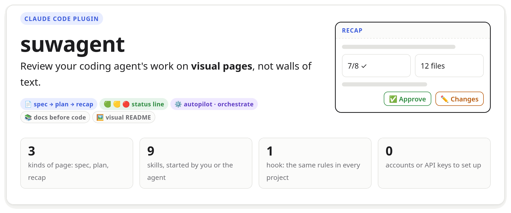
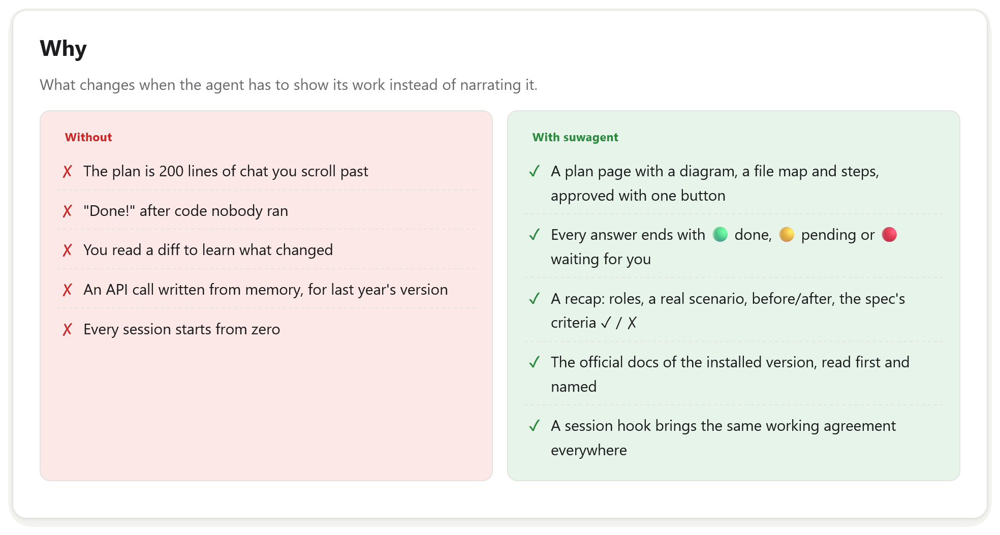
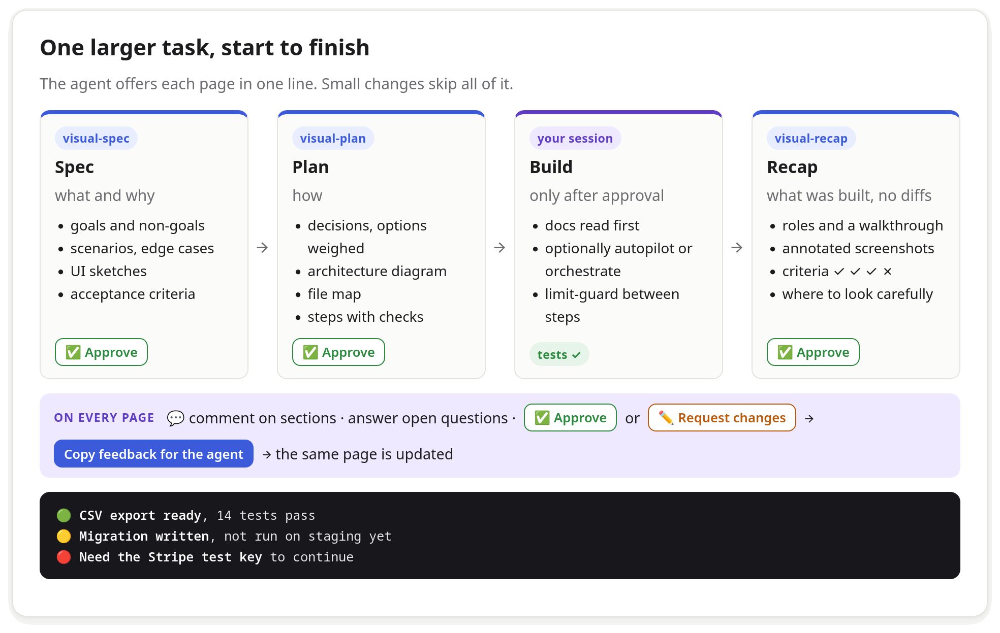
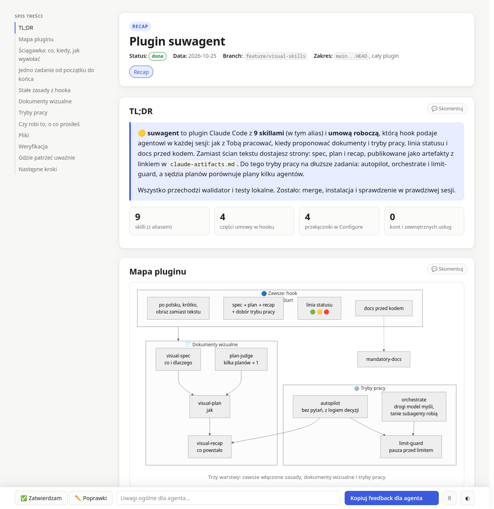
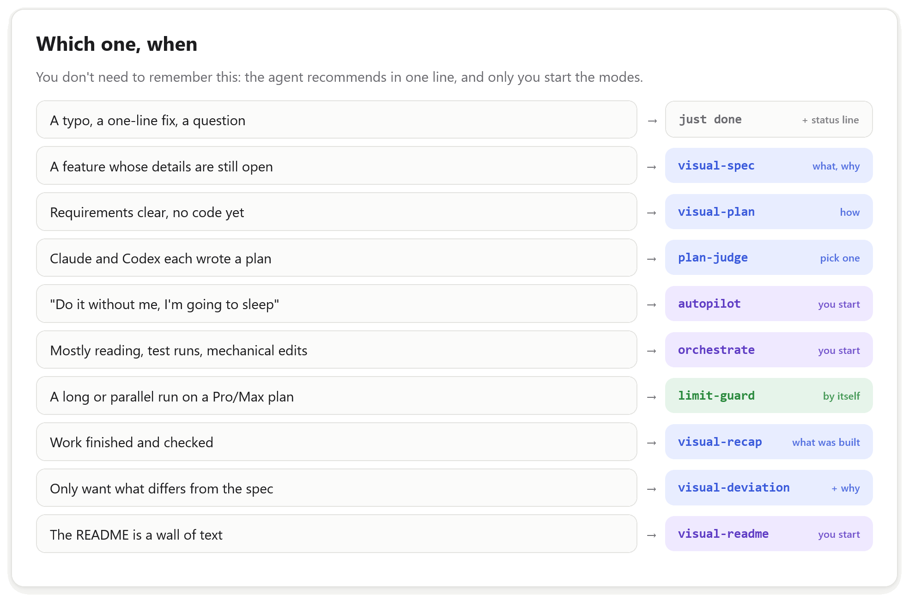
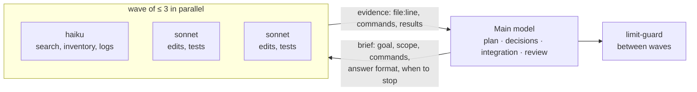
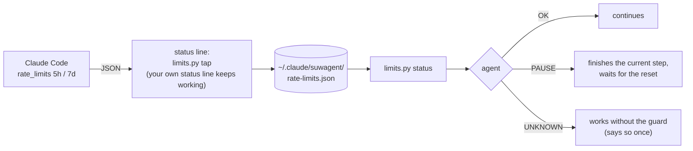
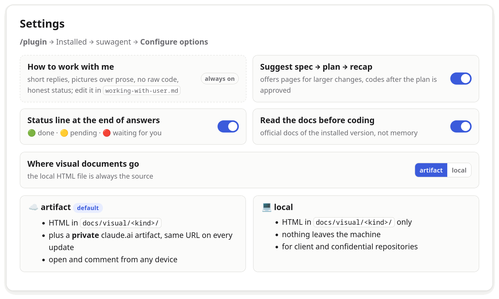

<picture>
  <source media="(prefers-color-scheme: dark)" srcset="docs/visual/board/img/readme/hero-dark.png">
  
</picture>

## Install

In a Claude Code session:

```
/plugin marketplace add Manomenu/suwalski-agent-plugin
/plugin install suwagent@suwalski-agent-plugin
```

Pick a scope (user scope gives it to you in every project), then type `/suwagent:` to see the skills.
Requirements: `git` and `python3` (standard library only).

> [!NOTE]
> **The working agreement is the owner's.** Replies come in the language you write in, Polish or
> English, short, with pictures over prose. To change any of it, fork the repository and edit
> [`working-with-user.md`](plugins/suwagent/hooks/context/working-with-user.md)
> ([Make it yours](#make-it-yours)).

<picture>
  <source media="(prefers-color-scheme: dark)" srcset="docs/visual/board/img/readme/why-dark.png">
  
</picture>

## How it works

<picture>
  <source media="(prefers-color-scheme: dark)" srcset="docs/visual/board/img/readme/flow-dark.png">
  
</picture>

You don't have to remember any command: the agent offers each page in one line when a task is big
enough. Every page is a self-contained HTML file in `docs/visual/<spec|plan|recap>/`, and by
default also a private claude.ai artifact you can open and comment on from any device.

This is what one looks like — [the recap of this repository](docs/visual/recap/2026-10-25-suwagent-plugin.html), in Polish:

<picture>
  <source media="(prefers-color-scheme: dark)" srcset="docs/assets/recap-dark.png">
  
</picture>

## The skills

<picture>
  <source media="(prefers-color-scheme: dark)" srcset="docs/visual/board/img/readme/skills-dark.png">
  
</picture>

<picture>
  <source media="(prefers-color-scheme: dark)" srcset="docs/visual/board/img/readme/choose-dark.png">
  
</picture>

All skills are invoked as `/suwagent:<name>`; `/suwagent:efficient-frontier` is an alias of
`orchestrate`. Only you start `autopilot`, `orchestrate` and `visual-readme`.

The pictures in this README were made by `/suwagent:visual-readme`: panels on a board page,
drawn with the same styles as the spec, plan and recap pages and rendered in both themes.

<details>
<summary><b>orchestrate</b> and <b>limit-guard</b>, inside</summary>





limit-guard needs a one-time `/suwagent:limit-guard setup`, which adds the status line tap.

</details>

## Settings and privacy

<picture>
  <source media="(prefers-color-scheme: dark)" srcset="docs/visual/board/img/readme/settings-dark.png">
  
</picture>

- An artifact is private until you share it; its link is recorded in `docs/visual/<kind>/claude-artifacts.md`.
- Pages load Mermaid and highlight.js from public CDNs; offline they still read, with diagram source in place of diagrams.
- `limit-guard` keeps a usage snapshot in `~/.claude/suwagent/rate-limits.json`. No accounts or API keys.

## Make it yours

The working agreement is plain Markdown that a `SessionStart` hook adds to every session
(on start, `/clear` and compaction):

| File | Part |
| :- | :- |
| [`working-with-user.md`](plugins/suwagent/hooks/context/working-with-user.md) | language, length, pictures over prose, no raw code, honest status (always on) |
| [`visual-workflow.md`](plugins/suwagent/hooks/context/visual-workflow.md) | when to offer a spec, plan or recap, and which way of working to recommend |
| [`quick-recap.md`](plugins/suwagent/hooks/context/quick-recap.md) | the 🟢 🟡 🔴 status line |
| [`mandatory-docs.md`](plugins/suwagent/hooks/context/mandatory-docs.md) | docs before code |

Fork the repository, change `working-with-user.md`, and install from your fork with
`/plugin marketplace add <you>/suwalski-agent-plugin`.

## Updates and removal

<details>
<summary>Auto-update, update now, disable, uninstall</summary>

Your installed copy is cached and does not change on its own.

| | |
| :- | :- |
| **Auto-update** | `/plugin` → **Marketplaces** → `suwalski-agent-plugin` → **Enable auto-update** (off by default for third-party marketplaces); the new version loads in the next session or after `/reload-plugins` |
| **Update now** | `/suwagent:update` runs the update commands for you; or `/plugin` → **Installed** → suwagent → **Update now**; or `claude plugin update suwagent@suwalski-agent-plugin` |
| **Turn off** | `claude plugin disable suwagent@suwalski-agent-plugin` |
| **Remove** | `claude plugin uninstall suwagent@suwalski-agent-plugin`; your pages in `docs/visual/` stay |

`plugin.json` has no `version` on purpose, so every pushed commit is a new version.
Plugins installed on your machine are not loaded in cloud sessions (claude.ai/code).

</details>

## Troubleshooting

<details>
<summary>Common problems</summary>

| Symptom | Fix |
| :- | :- |
| `/suwagent:` skills don't show up | `/reload-plugins`; if still missing, see the **Errors** tab in `/plugin` |
| No spec offers or status line | check **Configure options**, then start a new session (the hook runs at session start) |
| Diagrams show as source text | the page couldn't reach the Mermaid CDN (offline or blocked) |
| limit-guard says `UNKNOWN` | run `/suwagent:limit-guard setup` once; until then the agent works without the guard |
| A page looks broken | `python3 plugins/suwagent/scripts/vdoc.py check <page.html>` lists what is wrong |

</details>

## Develop

<details>
<summary>Commands and repository layout</summary>

```bash
claude --plugin-dir ./plugins/suwagent        # try local changes without installing
claude plugin validate .                      # check the marketplace and the plugin
python3 plugins/suwagent/scripts/vdoc.py check docs/visual/recap/2026-10-25-suwagent-plugin.html
python3 plugins/suwagent/scripts/vdoc.py render docs/visual/board/readme.html   # redraw the README pictures
```

After editing the plugin in a running session, run `/reload-plugins`.

```
.claude-plugin/marketplace.json     the catalog: lists the plugins in this repository
plugins/suwagent/
  .claude-plugin/plugin.json        manifest: name, description, userConfig
  skills/visual-{spec,plan,recap}/  the visual document skills (SKILL.md each)
  skills/visual-readme/             the README told in pictures, from a board page
  skills/mandatory-docs/            docs-before-code procedure
  skills/autopilot/ orchestrate/ plan-judge/ limit-guard/   ways of working
  skills/efficient-frontier/        alias of orchestrate
  skills/update/                    updates the installed plugin
  shared/template.html              the page: CSS + JS that render every block
  shared/authoring.md               rules shared by the visual skills
  shared/components.md              the block catalog (HTML snippets)
  scripts/vdoc.py                   new / check / open / links / register / refresh / shot / render
  scripts/limits.py                 status line tap and usage check for limit-guard
  scripts/session-context.sh        prints the working agreement, part by part
  hooks/hooks.json                  SessionStart → scripts/session-context.sh
  hooks/context/*.md                the working agreement
docs/visual/                        visual documents of this repository (a real recap example)
docs/visual/board/readme.html       the source of the README pictures → img/readme/<panel>-light/dark.png
```

To change a README picture, edit its section in `docs/visual/board/readme.html` and run the
`render` command above (Firefox or Chrome; `--only <id>` redraws one).

A `CLAUDE.md` inside a plugin is **not** loaded: always-on instructions go in a hook like the one
above, and instructions for a task go in a skill.

</details>

## Credits

Inspired by [BuilderIO/skills](https://github.com/BuilderIO/skills) (MIT, © Builder.io):
`/visual-plan` and `/visual-recap` gave the idea for the visual documents, and the status line
and `mandatory-docs`, `autopilot`, `plan-judge`, `orchestrate` and `limit-guard` are adapted from
their `quick-recap`, `read-the-damn-docs`, `plow-ahead`, `plan-arbiter`, `efficient-frontier` and
`stay-within-limits`. Their visual skills need Builder's hosted Plans app; suwagent writes plain
HTML into the repository and publishes it as a claude.ai artifact, or keeps it local.

[MIT](LICENSE) © 2026 Piotr Gugnowski
