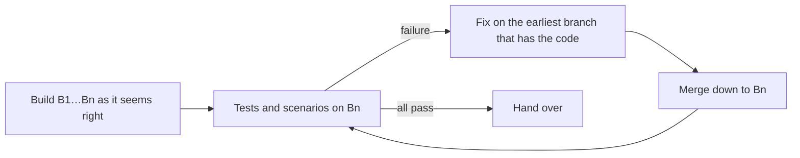

# MR chain

A chain is an ordered list of branches `B1 → B2 → … → Bn`. Each `Bk` contains `Bk-1`: it was
branched from it, and later changes reach it by merge. Its MR targets `Bk-1`. A reviewer reads
each MR on its own and should be able to ask one question of it, "does this do its part?". So
**every MR shows its own final shape**, and no MR redoes the work of an earlier one.

Task: $ARGUMENTS

Starting a chain has four phases: **split** (the user approves it), **build** (MR by MR, as the
work seems right, without running tests), **test and fix** (on the last branch, each fix in its
own MR, merged down), and **hand over** (push, MR table, recap). On an existing chain, start from
section 4.

**Why this order:** the intermediate states of a chain rarely work anyway, so testing each MR
spends time on failures that a later MR removes. Building the whole chain first and testing once,
at its end, finds the real problems, and section 4 puts each fix where it belongs.

## 1. Split the feature into MRs

Before any branch exists, decide the MRs and get the user's approval.

**Inputs.** If an approved plan exists in `docs/visual/plan/`, split its steps. If there is none
and the feature is large, suggest `/suwagent:visual-spec` or `/suwagent:visual-plan` in one line
first. Ask for the ticket id if the project's conventions use one and nobody gave it.

**What makes a good MR:**

- **One question for the reviewer.** It is about one thing: a contract, a data change, one
  mechanism, one feature built on it. "While I'm here" changes go elsewhere (section 6).
- **It is complete at its end, not proven.** It has its final shape and passes the cheap static
  checks the project has (build, lint, scenario validation). Tests and evaluation runs wait for the
  end of the chain (section 7).
- **Dependencies first.** A typical order:
  1. tests or evaluation scenarios that pin the behaviour (when the project works test-first or
     scenario-first, they come first and may fail until later MRs land);
  2. renames, moves and contracts that later MRs build on;
  3. data and content;
  4. the core mechanism;
  5. features on top of it, from the simplest to the most complex;
  6. removing what the chain replaces. This can come early, right after the tests, so later MRs
     build on cleared ground instead of next to the old system (section 5).
- **Data apart from code.** A big content or data change is its own MR, so reviewers of the code
  don't scroll past thousands of data lines.
- **A size a reviewer finishes in one sitting**: roughly up to 400 changed lines of code,
  without generated files and data. Larger means another split, unless the user prefers fewer
  MRs.
- **Nothing that a later MR rewrites.** If MR k introduces something MR k+m will change, the
  split is wrong, or MR k should already have the final shape (section 3).

**Branch names:** `<TICKET>-<NN>-<kebab-slug>`, with a two-digit index and a slug of 2-4 words,
for example `SR-108-01-hurricane-scenarios`. Use the project's own pattern if its CLAUDE.md or
AGENTS.md names one. The base is the default branch unless the user says otherwise.

**Show the split** as a table: index, branch, what it does, done-when (the check that proves the
MR works). When a visual plan exists, put the split there as a section `data-role="chain"`, with
the `flow` block (at most three MRs per row) and the table, and republish the page. Otherwise
show the table in chat. Done-when names what the MR must achieve; it is checked at the end, on
the last branch. Create branches only after the user approves the split.

## 2. Create the branches one at a time

Create each branch when its work starts, from the previous one, not all at once. Empty branches
made in advance turn every fix on an early MR into a round of merges through branches that hold
nothing yet.

```bash
git checkout <base> && git checkout -b SR-108-01-hurricane-scenarios
# … MR 1 done, static checks pass …
git checkout -b SR-108-02-hurricane-knowledge-base        # from SR-108-01
```

With git-town configured (section 10), `git town append <next-branch>` does the same and records
the parent.

## 3. Build MR by MR

- **Work on one branch at a time**, and commit with the tool the project prescribes (its
  CLAUDE.md, CLAUDE.local.md or AGENTS.md), including its ticket prefix.
- **Do it the final way the first time.** Before writing code in MR k, check the split: will a
  later MR change this again? If yes, write the final version now. Typical churn:
  - names, paths, folders or config keys introduced in MR k and renamed in MR k+m;
  - a script written whole in one MR and split in a later one, when the split was foreseeable;
  - a test replaced in a later MR instead of extended, so earlier assertions are lost;
  - copying a file instead of `git mv`, which hides the real diff;
  - documentation lines edited in two MRs when one would do.
- **Good enough, not perfect.** Build each MR the way it seems right and move on once it looks
  done and its static checks pass. Don't run tests or evaluation scenarios per MR; the end of the
  chain shows what is actually wrong (section 7). Then branch the next one from it.
- **Tell the user** after each MR in one or two lines: what landed, what the check showed, which
  MR comes next.

## 4. Where a change goes: the earliest branch that has the code

Write down the chain order first (branches, MR numbers, targets), and confirm it from git rather
than from memory:

```bash
git merge-base --is-ancestor B1 B2 && echo ok          # each link of the chain
git rev-list --count origin/Bk..Bk                       # unpushed commits, per branch
```

Every fix, rename, simplification or redesign goes as a **new commit on the earliest branch that
introduced the code it touches**. It then travels down the chain by merge. It never piles up in
the newest MR.

- Find that branch with `git log --oneline <base>..Bn -- <path>` or
  `git log -S'<symbol>' <base>..Bn`. The oldest chain commit that added the code decides.
- Code that predates the chain (it is in the base) is outside the chain. Fix it on the first
  chain branch only if the chain needs the fix; otherwise it is a separate task.
- New usages of a renamed or moved thing that appear only in a later branch are fixed **on that
  later branch**, during the merge or in a small commit right after it.
- When a later MR introduces a dependency bump, a config scheme, a naming convention or a folder
  layout that earlier MRs should already have used, move it to the earliest MR where it first
  matters.

**Propagate by merging down, and never rewrite:**

```bash
git checkout B(k+1) && git merge --no-ff Bk     # repeat to the end of the chain
```

- Never rebase, reset or force-push a pushed chain branch unless the user asks. Mistakes are
  fixed by new commits.
- Resolve conflicts **in favour of the new design**, and keep everything the later branch added.
- Go down in one pass: fix on k, merge into k+1, fix what k+1 itself introduced, merge on. This
  keeps the number of merge commits small.
- A merge commit may not compile on its own when the next commit adapts the branch. Say so in
  the report; don't rewrite history to hide it.

## 5. Code a later MR deletes: leave it alone

Prefer deleting the old system early in the chain (section 1), so nothing needs this section.
When the chain ends by deleting an old system, earlier MRs **don't edit files that will be
deleted**. That means no patches to keep the old system working and no temporary markers in code
that is going away. The old system may stay broken between those MRs. Agree on this with the user
once, then apply it, after checking that nothing else (CI, the build, another bot or tenant)
needs the deleted thing in the meantime.

Temporary markers (`TEMPORARY … <ticket> MR NN`) are only for staging **inside code that stays**:
a placeholder that a named later MR fills in, and that MR removes the marker. List them per
branch (`git grep -n TEMPORARY Bk`) to check that none outlives the MR it names.

## 6. New work that comes up during the chain

Something new (observability, a helper, a follow-up, an unrelated bug) is not slipped into
whatever MR is open. It goes to one of three places:

- the earliest MR it belongs to, when that MR doesn't work without it;
- a **new MR at the end of the chain**, branched from the current last one;
- a separate task.

Ask the user which one, once, and do what they decide.

## 7. Test at the end, fix in place

This is the default way of working on a chain:



- Tests, end-to-end and evaluation runs start only **when the whole chain exists** and looks like
  it should work. Run them **on the last branch**, never on intermediate ones.
- For each failure, find the MR that owns the code (section 4), commit the fix there, merge down
  to `Bn`, and run the failing tests again on `Bn`. Don't patch the newest MR to make a failure go
  away.
- Repeat until the chain passes. Loop over every branch only when the user asks, or before the
  first push.
- Expensive end-to-end, evaluation or live runs use a small subset (a tag, a filter) while fixing,
  and the full set once at the end.
- Report the net size per MR, before (origin) and after (local):
  `git diff --shortstat origin/Bk-1 origin/Bk` compared with `git diff --shortstat Bk-1 Bk`.

## 8. Several agents, one chain

- Only **one agent at a time** works on the chain's branches in one working tree, because one
  agent's checkouts and merges break another's.
- Only **one agent at a time** restarts or reseeds shared infrastructure (docker stacks, test
  databases, locally installed tools).
- Parallel work is fine across different repositories, read-only against refs, or in a separate
  git worktree that doesn't touch the shared infrastructure.
- Give every subagent: the chain order, the earliest-branch rule, merging down with `--no-ff`, no
  rebase, force or push, what it may restart, and to report its commits per branch. Under
  `/suwagent:orchestrate`, the main session owns the working tree and runs the merges.

## 9. Pushing and handing over

- **Files that later branches ignore.** Early branches don't yet have the `.gitignore` entries a
  later MR adds. Before committing on them, put such paths in `.git/info/exclude` (local, never
  committed), so a tool that commits the whole tree doesn't commit secrets or generated files.
- **Push only when the user says so**, and then push the **whole chain** at the end of a round,
  never branches half-way through a merge pass. Use the project's tool. If it refuses to push a
  branch with nothing to commit, check its flags first, and fall back to plain `git push` only
  with the user's consent.
- **Verify the push:** after `git fetch`, `git rev-list --count origin/Bk..Bk` is 0 for every
  branch.
- **Give the MR table:** branch, MR number, target branch. MRs opened by tooling often target the
  default branch, so tell the user to set each target to the previous chain branch.
- **One recap for the chain.** When the chain is done, a `/suwagent:visual-recap` of the whole
  chain (range: base to `Bn`), with a per-MR table: what each MR does, its size and its checks.

## 10. git-town for the mechanics

[git-town](https://www.git-town.com) remembers each branch's parent and does the mechanical
parts: a new branch at the end, merging changes down, stopping on conflicts and resuming. It
works with GitLab and GitHub and on Windows. Use it when it is installed (`git town --version`).
Everything in this skill also works with plain git. Flags change between versions, so check
`git town <command> --help` before relying on one.

git-town creates branches and merge commits only and never commits your work, so it doesn't
clash with a commit tool. Switch off its pushing, because the chain is pushed only when the user
says so.

One-time setup per repository:

```bash
git config git-town.sync-feature-strategy merge     # merge down, never rebase
git config git-town.push-new-branches false         # new branches stay local
git config git-town.forge-type gitlab               # or github; self-hosted GitLab: also git-town.hosting-origin-hostname
git town set-parent <parent>                         # once per existing chain branch, from B1 to Bn
git town branch                                      # shows the chain as a tree: check the order
```

`B1`'s parent decides what a sync merges into the start of the chain. Set it to the base the
chain targets, and sync the whole stack only when the base's new commits are meant to come in.

| Need | Command |
|---|---|
| New MR at the end of the chain | on `Bn`: `git town append <new-branch>` |
| Propagate a fix made on `Bk` down the chain | `git town sync --stack --no-push` |
| Conflict during a sync | resolve, `git add`, `git town continue`; `git town skip` leaves that branch for later; `git town undo` reverts the whole sync |
| Move between chain branches | `git town switch`, `git town up`, `git town down` |
| MR with the right target branch | `git town propose`, or the project's own MR tool (then check the target) |

These stay with you: choosing the earliest branch for a change (section 4), the checks
(section 7), pushing the whole chain and checking every branch (section 9), and the targets of
MRs that other tools created.

## 11. Reviewing the finished chain

When the chain is complete and before the user merges it, offer one read-only review for
hindsight improvements. It runs against remote refs, never by checking out while someone works
in the tree: `git diff origin/Bk-1 origin/Bk`, `git show <ref>:<path>`, `git grep <ref>`. It looks
at four independent dimensions, which suit parallel read-only subagents:

1. **Churn**: what one MR introduces and a later MR changes again (section 3).
2. **Wasted edits**: edits to code a later MR deletes (section 5), and anything added and removed
   within the chain.
3. **Unneeded code**: features, guards, options or tests nobody needs. Confirm with `git grep` on
   the last branch before calling anything unused.
4. **Overcomplication**: layers, flags or scripts that the finished design shows to be simpler.

Each finding gives the MR that introduced it, the MR that changed it, the files, the simpler
shape, roughly how many lines it saves, and a confidence. Merge the four reports into one ranked
list, drop what you know to be justified, recommend an action per item, and let the user decide
before changing anything.

## 12. Reporting

After each round, report:

- what landed on which branch (a commit per branch);
- conflicts and how they were resolved;
- the size of each MR before and after;
- the checks and on which branch they ran;
- what was skipped and why;
- what is not pushed yet.

Keep the user's decisions as explicit questions: scope, the split, thresholds, pushing,
publishing.
